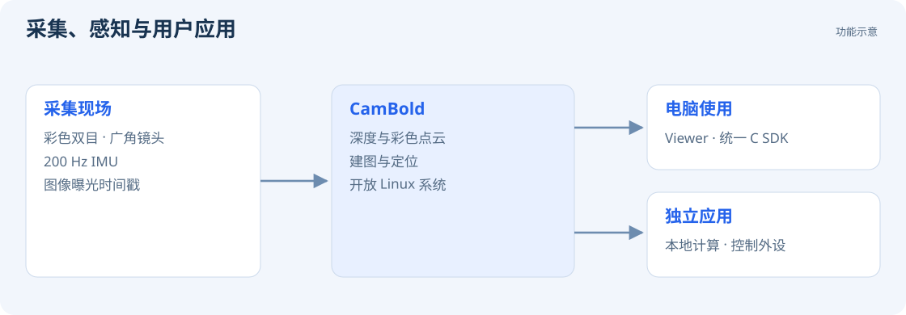

CAMBOLD · 用户与开发者文档

# CamBold 用户与开发者文档

CamBold 集成彩色双目相机、200 Hz IMU、深度感知与建图定位功能。Viewer 用于查看数据和控制相机，统一的 C SDK 用于开发电脑端和板端应用。

<a href="#/start/prepare">第一次使用</a><a href="#/development/host-sdk">编写 SDK 程序</a><a href="#/development/board">开发板端应用</a>

## 功能入口

| 用途 | 阅读顺序 |
| --- | --- |
| 查看双目图像 | [连接与供电](start/prepare.md) → [Windows 首次连接](start/windows.md) → [Camera 页面](guides/console.md) |
| 获取物体的三维位置 | [深度图与彩色点云](guides/depth.md) → [SDK 深度示例](development/depth.md) |
| 保存图像与 IMU 数据 | [录制 ROS1 rosbag](guides/recording.md) |
| 建图，或在已有地图中定位 | [SLAM 页面与地图管理](guides/slam.md) |
| 在自己的程序中接收数据 | [SDK 接入](development/host-sdk.md) → [完整 API 参考](reference/api.md) |
| 在相机上运行自己的程序 | [Linux、Wi-Fi 与 SSH](guides/files-terminal.md) → [板端开发](development/board.md) → [外设接口](development/peripherals.md) |

