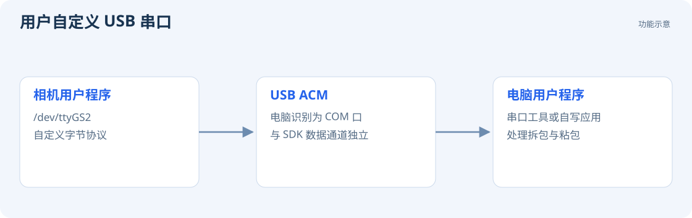

# 自定义 USB 串口

CamBold 提供独立的用户 USB ACM 通道，协议由用户自行设计。板端设备名为 **`/dev/ttyGS2`**，Windows 端显示为 COM 口；SDK 使用另一条数据通道。



## 板端回显示例

保存以下内容为 `/data/share/acm_echo.py`，先确认没有其他程序占用 `/dev/ttyGS2`：

```python
import os
import termios
import tty

fd = os.open('/dev/ttyGS2', os.O_RDWR | os.O_NOCTTY)
old = termios.tcgetattr(fd)
try:
    tty.setraw(fd)
    while True:
        data = os.read(fd, 4096)
        if not data:
            break
        pending = memoryview(data)
        while pending:
            n = os.write(fd, pending)
            pending = pending[n:]
except KeyboardInterrupt:
    pass
finally:
    termios.tcsetattr(fd, termios.TCSANOW, old)
    os.close(fd)
```

运行：

```bash
python3 /data/share/acm_echo.py
```

若无权限，可在测试时用 `sudo python3 ...`。正式应用应给指定用户配置设备权限。按 Ctrl+C 结束。

## 电脑端验证

1. 在 Windows 设备管理器中找到 CamBold 对应的用户串口号。
2. 用串口工具打开该 COM 口，例如设置 115200、8N1、无流控。
3. 发送一段文本，应收到原样回显。

115200 是串口工具的配置值，实际传输速率由 USB 链路决定。外接 UART 的使用方法见 [CAN / UART / I²C](development/peripherals.md)。

## 设计自己的协议

串口按字节流传输，一次读取可能包含部分消息或多条消息。应用需要定义长度、边界和校验，并通过接收缓存处理拆包与粘包。拔线后关闭旧句柄，重连时重新打开设备。
