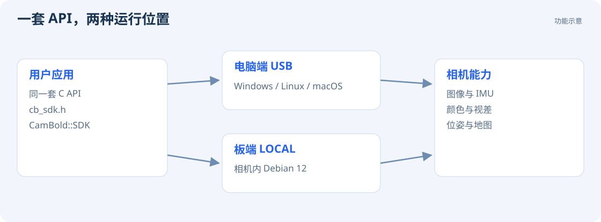

# 选择开发方式

CamBold SDK 使用一套 `cb_*` C 接口，供电脑端和板端应用控制相机、获取图像、IMU、同帧颜色与视差、位姿和地图。应用包含 `cb_sdk.h`，通过 CMake 链接 `CamBold::SDK`。



| 方式 | 运行平台 | CMake 选项 | 典型用途 |
| --- | --- | --- | --- |
| USB 后端 | Windows / Linux / macOS 电脑 | `CB_SDK_BACKEND=USB` | 桌面显示、机器人主机接入、数据采集 |
| LOCAL 后端 | 相机内部的 Debian 12 | `CB_SDK_BACKEND=LOCAL` | 本地感知、控制外设、独立运行应用 |
| 自定义 USB 串口 | 两端的用户程序 | 不属于 SDK 接入选项 | 自行设计协议、与其他控制软件交互 |

USB / LOCAL 后端在编译时选择，应用使用相同的公开 API。用户自定义的 `/dev/ttyGS2` 使用独立通道。

## 源码包中的内容

```text
cambold_sdk/
  include/cb_sdk.h       公开 C API
  examples/camera.c     两端共用的入门示例
  CMakeLists.txt        CMake 接入入口
  LICENSE              Apache-2.0
  THIRD_PARTY.md        第三方许可说明
```

`cambold_sdk` 是独立源码包，包含所需依赖，可复制到用户工程。SDK 使用 C11 / C++17 编译器，C 应用的 CMake 工程也需启用 CXX 语言。

## 各语言集成

公开头文件使用 C ABI，C / C++ 可直接调用。Python、C#、Rust 等语言可通过 C 绑定接入。当前构建入口生成静态 SDK；动态加载式 FFI 需要额外构建共享库封装，并按 [内存与线程规则](reference/api.md#内存与线程) 处理结构体、回调和内存。

先运行 [入门示例](development/host-sdk.md)，确认连接和数据正常，再集成到自己的程序。
