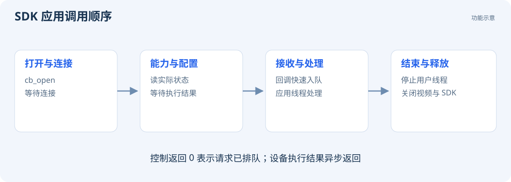

# 编译和运行第一个示例

## 准备环境

电脑端需要 CMake 3.16 或更新版本、支持 C11 / C++17 的编译器，以及构建工具。下面的 Windows 命令使用 PowerShell、MinGW-w64 和 Ninja。请先把 `cmake`、`gcc`、`g++`、`ninja` 所在目录加入 `PATH`，并验证：

```powershell
cmake --version
gcc --version
ninja --version
```

Linux / macOS 使用本机编译器；Linux 可通过包管理器安装 CMake、Ninja 和编译工具。板端构建见 [系统与交叉编译](development/board.md)。

## 编译 SDK 自带示例

在包含 `cambold_sdk` 的目录执行：

```powershell
cmake -S cambold_sdk -B build/sdk-usb -G Ninja -DCB_SDK_BACKEND=USB -DCB_SDK_BUILD_EXAMPLES=ON -DCMAKE_BUILD_TYPE=Release
cmake --build build/sdk-usb --parallel
```

示例程序位于 `build/sdk-usb/examples/cb_camera_example.exe`。Linux / macOS 的文件名没有 `.exe`。

连接相机，关闭 Viewer 及其他占用相机的程序，然后运行：

```powershell
# 运行 10 秒，开启 IMU 和视频，不开启深度
.\build\sdk-usb\examples\cb_camera_example.exe 10 1 1 0

# 运行 10 秒，开启视频和深度，不开启 IMU
.\build\sdk-usb\examples\cb_camera_example.exe 10 0 1 1
```

四个参数依次为**运行秒数、IMU、视频、深度**，开关使用 0 / 1。不传运行时间或时间为 0 时，程序持续运行，按 Ctrl+C 退出。终端输出设备名称、可选帧率、图像尺寸、时间戳、左右目曝光时长和深度帧信息。

先执行第一条命令验证采集，再执行第二条验证深度。深度功能需要有效标定，帧率规则见 [深度档位](guides/depth.md#可选分辨率与帧率)。

## Wiki 附带的文件输出示例

`docs/wiki/examples/host` 提供一个 C++ 示例，可查询信息、接收 IMU、保存 JPEG，或保存一帧颜色与视差：

```powershell
cmake -S docs/wiki/examples/host -B build/wiki-host -G Ninja -DCMAKE_BUILD_TYPE=Release
cmake --build build/wiki-host --parallel
.\build\wiki-host\cambold_example.exe info
.\build\wiki-host\cambold_example.exe imu 5
.\build\wiki-host\cambold_example.exe image stereo.jpg
.\build\wiki-host\cambold_example.exe depth sample
```

`depth sample` 生成 `sample.f16`、`sample.ppm`、`sample.json` 和 `sample.ply`，分别保存 FP16 视差、校正颜色、元数据和彩色点云。`.f16` 按 IEEE 754 binary16 格式读取。

## 在自己的 CMake 工程中使用

工程目录示例：

```text
my_project/
  CMakeLists.txt
  main.c
  cambold_sdk/
```

`CMakeLists.txt`：

```cmake
cmake_minimum_required(VERSION 3.16)
project(my_camera_app LANGUAGES C CXX)
set(CB_SDK_BACKEND USB CACHE STRING "")
add_subdirectory(cambold_sdk)
add_executable(my_camera_app main.c)
target_link_libraries(my_camera_app PRIVATE CamBold::SDK)
```

可在 SDK 示例 `camera.c` 的基础上添加处理逻辑。板端应用选择 `LOCAL` 后端，并使用 AArch64 工具链构建。

## 调用流程



按图中顺序建立连接、读取能力、配置设备和接收数据。异步结果、回调处理及退出顺序见 [调用规则](reference/api.md)。
