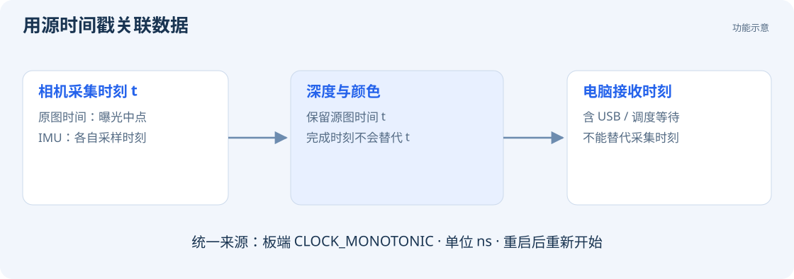

# 图像与 IMU

## 图像回调

视频句柄与控制句柄独立。应用可以先用 `cb_open()` 建立控制，再用 `cb_video_open()` / `cb_video_start()` 开启视频。

```c
#include <stdio.h>
#include "cb_sdk.h"

static void on_image(const cb_video_frame *f, void *user)
{
    (void)user;
    printf("%u x %u, %zu bytes\n", f->width, f->height, f->jpeg_size);
    if (f->flags & CB_VIDEO_TIMESTAMP_VALID)
        printf("source time: %llu ns\n",
               (unsigned long long)f->timestamp_monotonic_ns);
    if (f->flags & CB_VIDEO_EXPOSURE_LEFT_VALID)
        printf("left exposure: %u us\n", f->exposure_us[0]);
    /* 需要交给其他线程时，在本回调返回前复制 jpeg。 */
}
```

以下代码在应用线程执行，`video` 保留到使用结束：

```c
cb_video_t *video = NULL;
cb_video_config options = {0};
options.callback = on_image;
char error[256] = {0};
int rc = cb_video_open(&options, &video);
if (rc == 0) rc = cb_video_start(video, error, sizeof(error));
/* 使用结束后执行 cb_video_close(video)。 */
```

`jpeg` 包含左右并排的压缩图像，应用解码后可按左右两半拆分。图像尺寸读取 `width`、`height`，元数据有效性通过 `flags` 判断。

## 接收 IMU

给 `cb_config.callback` 设置事件回调。连接成功后，在应用线程调用 `cb_set_imu_output(camera, 1, cb_next_request_id(camera))`，并处理执行结果。

```c
#include <stdio.h>
#include "cb_sdk.h"

static void on_event(const cb_event *e, void *user)
{
    (void)user;
    if (e->type == CB_EVENT_RESULT) {
        printf("request %llu: %d\n",
               (unsigned long long)e->request_id, (int)e->result);
    } else if (e->type == CB_EVENT_IMU_BATCH) {
        cb_imu_sample samples[128];
        size_t count = sizeof(samples) / sizeof(samples[0]);
        if (cb_decode_imu_batch(e->payload, e->payload_size,
                                samples, &count) != 0) return;
        for (size_t i = 0; i < count; ++i) {
            /* samples[i].accel: m/s²; gyro: rad/s。复制到应用队列。 */
        }
    }
}
```

上例使用固定批次缓冲。返回 `-ENOSPC` 时，按函数回填的数量扩容并重新解码；也可预分配足够大的缓冲。

IMU 上传开机默认关闭，稠密运行时的上传规则见 [SLAM 接入](development/slam.md)。采集接口输出传感器数据，应用可根据自身标定进行纠正。

## 时间与同步



图像、IMU、深度和位姿使用板端单调时钟，单位为纳秒。图像时间对应曝光中点，深度保留源图像时间。跨数据流同步时，按源时间戳关联数据。

相机重启后，单调时钟重新开始。断线重连时清理旧数据缓存，并结合运行标识或时间戳识别新一轮数据。数据定义见 [结构与单位](reference/data.md)。
