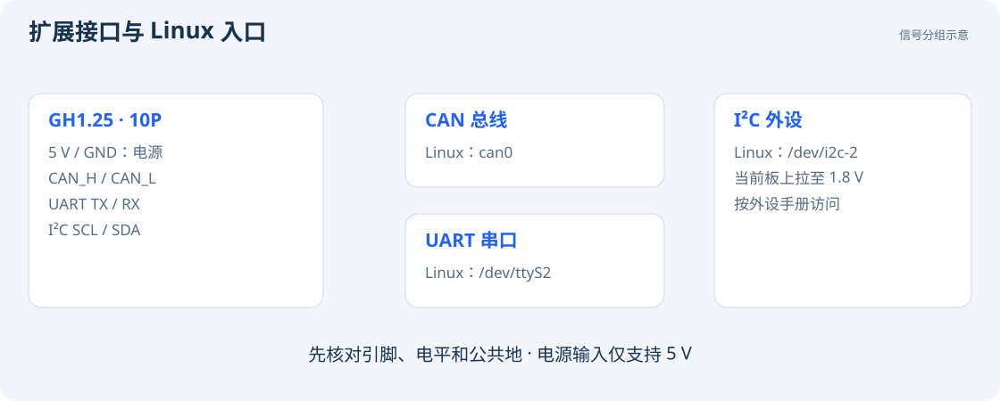

# CAN / UART / I²C

GH1.25 10P 提供 5 V 电源和 CAN、UART、I²C 接口。连接前先断开外设电源，按引脚编号核对信号与地线。



## 引脚信号

下表采用原理图的**电气引脚编号**。接线时对照实物的 1 脚标记，确认连接器和线材方向。

| 引脚 | 信号 | 用途 |
| --- | --- | --- |
| 1 | CAN_H | CAN 总线 H |
| 2 | CAN_L | CAN 总线 L |
| 3 | UART2_TXD | 相机 UART 发送，接对方 RX |
| 4 | UART2_RXD | 相机 UART 接收，接对方 TX |
| 5 | I2C2_SCL | I²C 时钟 |
| 6 | I2C2_SDA | I²C 数据 |
| 7、8 | GND | 信号地 / 电源地 |
| 9、10 | 5V_IN | 仅 5 V 电源输入 |

I²C 上拉至 **1.8 V**，连接 3.3 V / 5 V 外设时需使用电平转换。UART 使用逻辑电平，连接适配器前核实电压；连接 RS-232 设备需使用相应收发器。

## CAN：发送一帧测试数据

当前接口为 `can0`。准备另一台兼容 CAN 设备，连接 H、L 和参考地，在总线两端按规范配置终端电阻，并使双方波特率一致。

以下示例将波特率设置为 **500 kbit/s**：

```bash
sudo apt update
sudo apt install can-utils
sudo ip link set can0 down
sudo ip link set can0 type can bitrate 500000
sudo ip link set can0 up
ip -details -statistics link show can0
cansend can0 123#11223344
```

连接正常工作的对端，以完成 CAN 总线确认。另开终端执行 `candump can0` 查看接收，按 Ctrl+C 退出。测试完成后可执行 `sudo ip link set can0 down`。

## UART：确认设备与收发

当前外接 UART2 对应 `/dev/ttyS2`。先查看是否有其他应用使用它，然后根据对方设备设置波特率。例如 115200、8N1、无硬件流控：

```bash
ls -l /dev/ttyS2
sudo stty -F /dev/ttyS2 115200 raw -echo -crtscts cs8 -parenb -cstopb
```

使用串口程序打开该设备即可收发。回环测试时，断开其他外设，将本接口的 TX 接 RX，再发送测试字节。

## I²C：按外设手册访问

当前 I²C2 对应 `/dev/i2c-2`。先确认设备节点：

```bash
ls -l /dev/i2c-2
sudo apt install i2c-tools
i2cdetect -l
```

`i2cdetect -l` 列出系统中的 I²C 适配器。读写参数需按外设手册设置，包括 7 位地址、寄存器宽度、电压和初始化顺序。

以下示例从地址 `0x48` 的外设读取寄存器 `0x00`，使用 8 位寄存器地址，读取 1 字节：

```bash
sudo i2ctransfer -y 2 w1@0x48 0x00 r1
```

使用时，将地址、寄存器和读写长度替换为外设手册规定的值。
