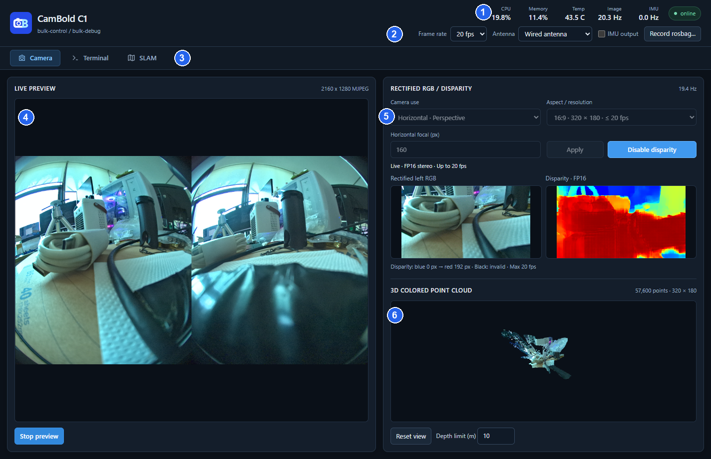

# Viewer 界面与图像

图中编号对应：

| 编号 | 区域 |
| --- | --- |
| 1 | 在线状态与系统指标 |
| 2 | 帧率、天线、IMU 与录制控件 |
| 3 | Camera / Terminal / SLAM 功能页 |
| 4 | 原始双目图像 |
| 5 | 深度参数、同帧校正颜色与视差 |
| 6 | 三维彩色点云与视角控制 |

## 顶部栏

| 控件或数值 | 含义与操作 |
| --- | --- |
| 设备名称 | 相机上报的产品名称 |
| `online` / `offline` | 当前与相机的连接状态 |
| `CPU`、`Memory`、`Temp` | 相机的 CPU 占用、内存占用和 SoC 温度；未启动 SLAM 时也会更新 |
| `Image`、`IMU` | 当前接收到的图像和 IMU 频率；未开启相应数据时为 0 |
| `Frame rate` | 设置相机帧率，可选项读取自相机 |
| `Antenna` | 选择板载陶瓷天线或外接天线；外接天线应先完成硬件连接 |
| `IMU output` | 控制向电脑上传 IMU；SLAM 内部的 IMU 独立运行 |
| `Record rosbag...` | 选择本机保存位置和录制内容 |

参数初值来自相机的实际状态，重启后的保存规则见 [配置保存](guides/settings.md#配置保存)。

## 三个功能页

- **Camera**：原始图像预览、深度设置、同帧校正颜色与视差、三维点云。
- **Terminal**：通过 USB 访问相机 Linux 终端，执行命令、配置 Wi-Fi。
- **SLAM**：创建和加载地图，显示实时位姿、关键帧、地图点云与跟踪图。

## 查看原始图像

1. 在 `Camera` 页面点击 `Start preview`。
2. 左侧显示左右并排的鱼眼图像，原始视频尺寸为 2160 × 1280。
3. 从顶部 `Frame rate` 选择所需帧率。
4. 停止预览时点击 `Stop preview`。

当前帧率档位为 30 / 20 / 15 / 10 fps。深度功能对帧率的限制见 [可选分辨率与帧率](guides/depth.md#可选分辨率与帧率)。

右侧点云窗口常驻，开启深度后显示彩色点云。操作见 [深度图与彩色点云](guides/depth.md)。
