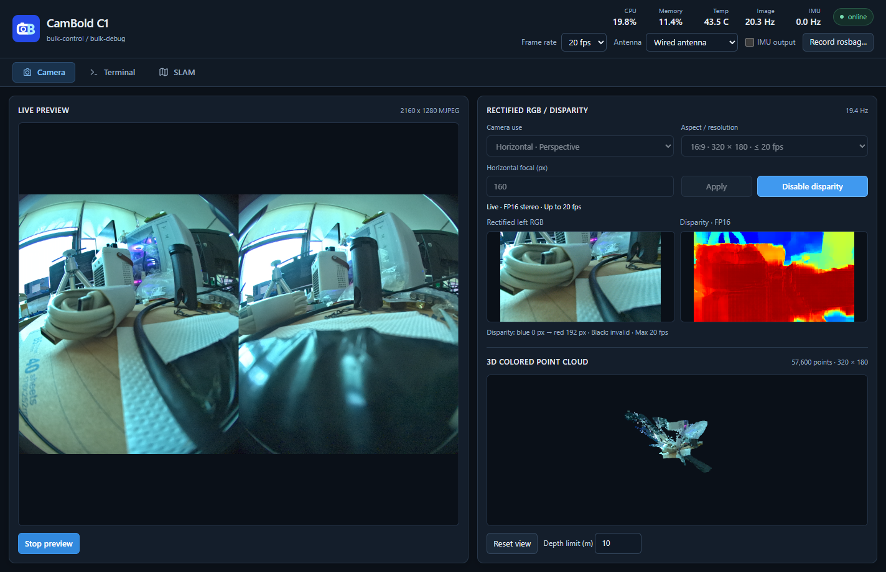
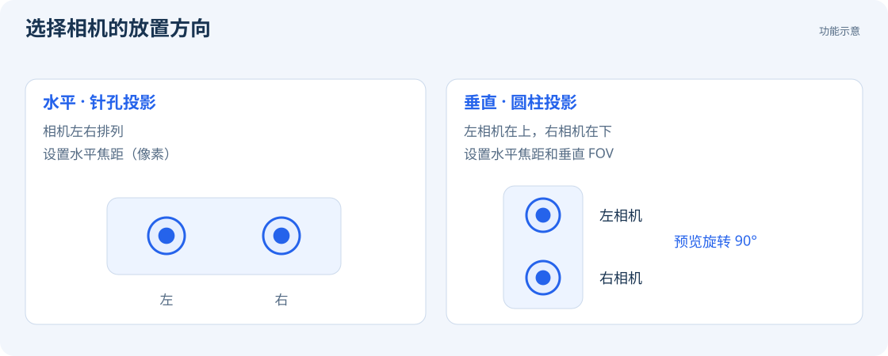
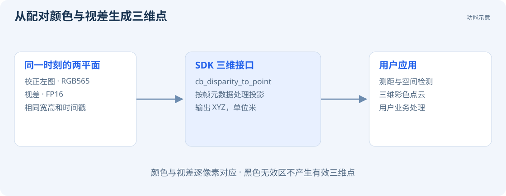

# 深度图与彩色点云

相机用左右图像估计视差，再结合相机几何参数计算三维位置。Viewer 同时显示同一帧的校正左目彩色图和视差图，并用两者生成彩色点云。

## 开启深度

1. 在 `Camera use` 中选择相机使用方向。
2. 从 `Aspect / resolution` 选择分辨率和帧率档位。
3. 设置 `Horizontal focal (px)`；垂直模式还需设置 `Vertical FOV (°)`。
4. 点击 `Apply` 等待设备应用设置。
5. 点击 `Enable disparity`。
6. 右侧显示校正图、视差和彩色点云，拖动点云可调整视角。

更改分辨率、投影和焦距前，应先停止 SLAM 并关闭深度。标定文件缺失时，界面会提示原因并禁止开启；标定维护见 [标定文件](guides/calibration.md)。

## 可选分辨率与帧率

当前固件提供以下档位，表中帧率为各模式的上限。Viewer 的可选项由设备上报。

| 相机使用方向 | 分辨率（宽 × 高） | 最高帧率 |
| --- | --- | --- |
| 水平 | 240 × 192、256 × 192、320 × 180、256 × 256 | 20 fps |
| 水平 | 320 × 256、320 × 240、384 × 216、288 × 288 | 15 fps |
| 水平 | 400 × 320、384 × 288、448 × 252、384 × 384 | 10 fps |
| 垂直 | 256 × 256 | 20 fps |

开启深度时，相机帧率超出所选模式上限会自动降档，已有较低帧率则保持不变。例如，30 fps 开启 10 fps 深度模式后降至 10 fps；10 fps 开启 20 fps 深度模式后仍为 10 fps。降档后的帧率会保存到设备，关闭深度后需从顶部栏重新选择较高帧率。

## 水平与垂直使用

| 设置 | 相机放置 | 投影及可设置参数 |
| --- | --- | --- |
| `Horizontal · Perspective` | 两只相机左右排列 | 针孔投影；设置输出图像的水平焦距，单位为像素 |
| `Vertical · Cylindrical` | 将相机竖起，**左相机位于右相机上方** | 圆柱投影；设置水平焦距和 30°～180° 的垂直 FOV |

`Horizontal focal (px)` 设置校正图的水平像素焦距。减小数值可扩大视野；超出镜头有效成像范围的部分显示为无效区域。

垂直模式下，Viewer 将预览旋转 90°。SDK 按帧元数据返回宽高和像素坐标，应用根据投影参数处理几何关系。

## 视差、深度和彩色点云

视差表示同一场景点在左右图像中的水平位置差，单位为像素。视差图用蓝色表示小视差、红色表示大视差、黑色表示无效区域。

SDK 输出 **FP16 视差**及与其逐像素对应的 **RGB565 校正左图**，两者具有相同的尺寸、时间戳和投影参数。`cb_disparity_to_point()` 将视差转换为以米为单位的三维坐标，支持针孔和圆柱两种投影。详见 [SDK 深度接入](development/depth.md)。

## 点云查看

用鼠标左键拖动旋转、滚轮缩放；`Reset view` 恢复初始视角。`Depth limit (m)` 设置点云的显示距离上限。

玻璃、反光表面、大片无纹理区域、遮挡边缘和很远的物体可能缺少有效深度。远处视差较小，像素误差对距离的影响更明显；应用应检查有效性和工作距离。
