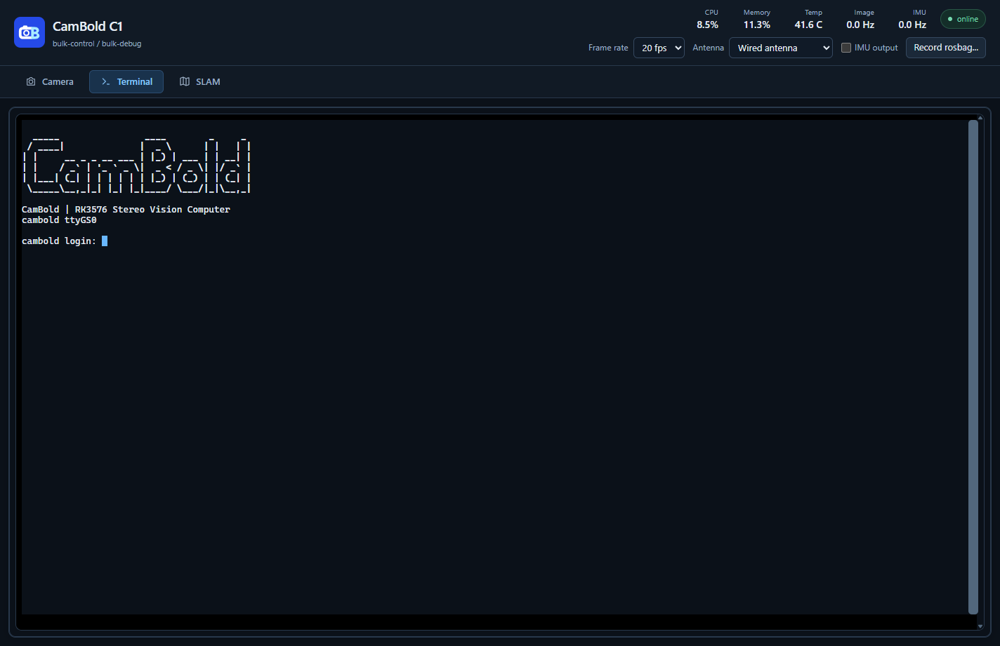

# 文件、终端与 Wi-Fi

## 通过 MTP 传文件

Windows 文件资源管理器中的 CamBold 设备对应相机的 `/data/share`。该目录用于存放用户程序、数据和地图，支持与电脑互相复制文件。

地图保存完成后再复制，MTP 传输结束后再断线。传入的 Linux 程序可在终端中通过 `chmod +x` 添加执行权限。

## 打开 Linux 终端

在 Viewer 中选择 `Terminal`，通过 USB 调试通道访问相机的本地 shell。SSH 则通过网络远程登录相机。



出现登录提示时输入设备账号。当前出厂账号和密码均为 `cambold`。终端隐藏密码输入，输完后按回车。登录后可用 `passwd` 修改密码。

## 第一次使用命令行

终端中一行一条命令，输入后按回车执行。复制代码块中的命令时，仅复制命令内容，省略提示符 `$` 或 `#`。

| 命令 | 作用 |
| --- | --- |
| `pwd` | 显示当前目录 |
| `ls -lh /data/share` | 查看共享目录中的文件与大小 |
| `cd /data/share` | 进入共享目录 |
| `mkdir -p /data/share/my_app` | 创建用户应用目录 |
| `df -h /data` | 查看存储空间 |
| `free -h` | 查看内存 |
| `top` | 查看进程，按 `q` 退出 |
| `cat /etc/os-release` | 查看系统版本 |
| `sudo reboot` | 重启相机；操作前先停止录制和建图 |

`sudo` 表示以管理员权限执行命令，需要时输入设备密码。路径以 `/` 开头表示从系统根目录定位。Linux 区分大小写，`Map.db` 与 `map.db` 是不同文件。Ctrl+C 可以中止当前前台命令。

## 连接 Wi-Fi

当前固件使用 NetworkManager。先查看网卡和附近网络：

```bash
nmcli device status
nmcli device wifi list
```

将 `YourWiFi` 替换为网络名称。`--ask` 通过交互提示读取密码：

```bash
sudo nmcli --ask device wifi connect "YourWiFi"
hostname -I
```

最后一条命令输出相机的 IP 地址。相机与电脑需要处于可互通的网络；可让相机连接电脑热点，也可让两者连接同一个路由器。

## 从电脑使用 SSH

在 Windows PowerShell、Linux 或 macOS 终端执行，地址替换成刚查到的相机 IP：

```bash
ssh cambold@192.168.1.100
```

首次连接会提示确认主机指纹。确认目标设备后输入 `yes`，再输入密码。登录成功后看到的文件系统与 Viewer 终端相同。输入 `exit` 退出 SSH。

在**电脑端**执行以下命令，将文件复制到相机：

```bash
scp my_app cambold@192.168.1.100:/data/share/
```

更换网络或重启后，IP 地址可能变化。连接失败时，在 Viewer 终端重新运行 `hostname -I` 核对地址。
