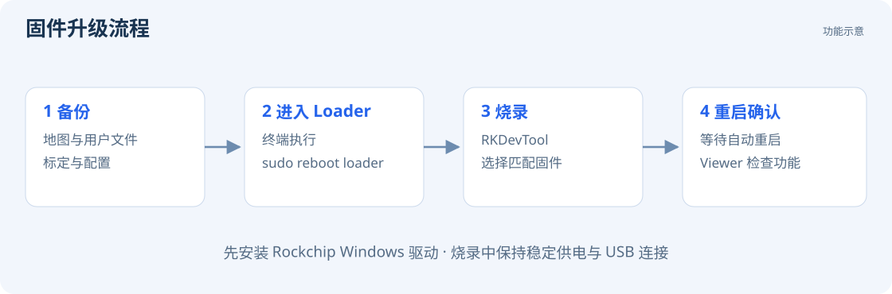

# 固件升级

CamBold 支持使用 Rockchip Windows 工具烧录固件。

## 准备工具

| 文件或工具 | 用途 | 下载 |
| --- | --- | --- |
| Rockchip Windows 驱动 | 让电脑识别 Loader 烧录设备 | 下载地址待提供 |
| RKDevTool | Windows 烧录工具 | 下载地址待提供 |
| 与设备匹配的固件 | 更新系统 | 固件下载地址待提供 |

安装 Rockchip 驱动后，用可靠的 USB 数据线直连相机和电脑，并保持稳定供电。

## 升级步骤



1. 停止 Viewer 中的录制和 SLAM，等待文件保存完成。
2. 备份 `/data/share` 中的重要文件，以及 `/data/eeprom` 中的标定和配置。
3. 在 Viewer 的 `Terminal` 页面执行：

   ```bash
   sudo reboot loader
   ```

4. 相机进入 Loader 模式，Viewer 连接断开。
5. 打开 RKDevTool，等待工具提示识别到 **Loader** 设备。
6. 在工具的固件升级页面选择与本设备匹配的完整固件，开始升级。
7. 烧录期间保持电源和 USB 连接，等待工具报告成功。
8. 相机自动重启后，重新打开 Viewer，确认图像、深度和所需功能正常。

若 RKDevTool 未发现 Loader 设备，检查 Rockchip 驱动、数据线和 USB 接口。
