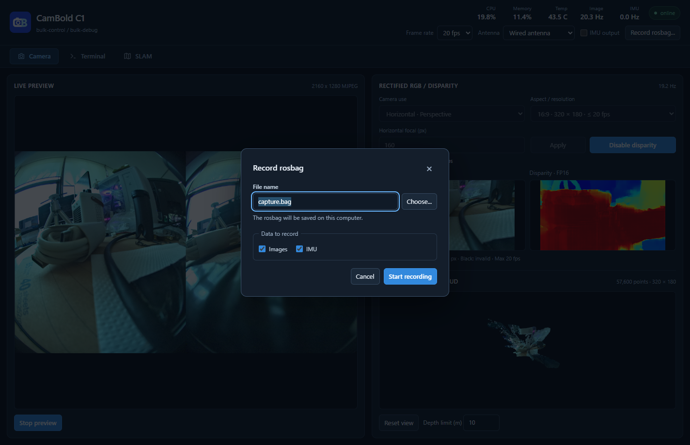

# 录制 ROS1 rosbag

Viewer 将相机图像和 IMU 保存为电脑上的 ROS1 rosbag 文件，供 ROS1 工具读取。Windows 录制端可直接运行 Viewer，无需安装 ROS。



## 操作步骤

1. 连接相机，点击顶部 `Record rosbag...`。
2. 在 `File name` 输入文件名，或点击 `Choose...` 选择电脑上的保存位置。
3. 按需要勾选 `Images` 和 `IMU`，至少选择一项。
4. 点击 `Start recording`。程序会打开所选数据流；勾选 IMU 时会自动开启 IMU 上传。
5. 完成后点击停止录制，等待文件关闭，再退出程序或断开设备。

录制前检查**电脑**的剩余空间，确认足以容纳计划录制的数据。

## Topic 与消息类型

| Topic | ROS1 消息类型 | 内容 / frame_id |
| --- | --- | --- |
| `/camera/left/image/compressed` | `sensor_msgs/CompressedImage` | 左目 JPEG；`camera_left_optical` |
| `/camera/right/image/compressed` | `sensor_msgs/CompressedImage` | 右目 JPEG；`camera_right_optical` |
| `/imu/data` | `sensor_msgs/Imu` | 加速度与角速度；`imu_link` |

左右图像分别保存为 JPEG，消息的 `format` 为 `jpeg`。消息使用板端源时间戳，图像时间对应曝光中点。IMU 加速度单位为 m/s²，角速度单位为 rad/s；本消息不提供姿态，`orientation_covariance[0]` 为 `-1`。

## 用 ROS1 工具检查

把文件放到安装 ROS1 的电脑中，可执行：

```bash
rosbag info capture.bag
rosbag play --clock capture.bag
```

`rosbag info` 查看 topic、时长和消息数量；`rosbag play` 播放录制的数据，按 Ctrl+C 停止。

USB 稠密 SLAM 运行时，电脑端 SDK 会关闭 IMU 上传，此时不能同时录制该连接的 IMU。可先停止稠密 SLAM，或根据应用改用板端 LOCAL SDK。

SDK 另提供板端录制接口，其文件保存位置和参数限制见 [板端录制 API](reference/api-terminal.md#cb_rosbag_start)。
