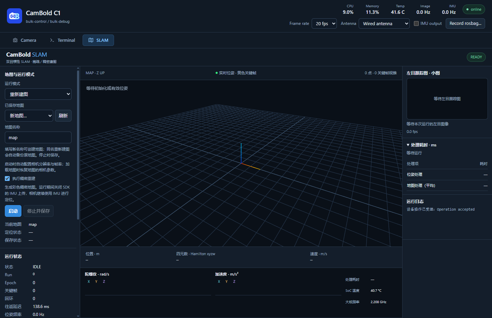
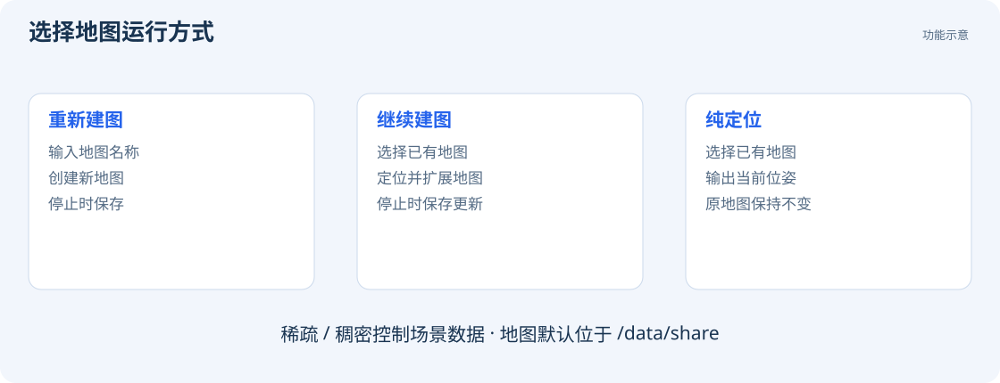

# SLAM 与地图管理

Viewer 的 SLAM 页面提供新建地图、继续建图和纯定位功能。



## 第一次建图

1. 点击 `SLAM` 页，等待连接状态为 `READY`。
2. 在“运行模式”中选择“重新建图”。
3. 输入地图名称，例如 `office_1`，建议使用字母、数字、下划线或短横线。
4. 按需要勾选“执行稠密重建”。
5. 点击“启动”。程序会根据运行需要自动调整相机配置。
6. 等待初始化完成和位姿出现，再缓慢移动相机观察场景。
7. 结束时点击“停止并保存”，等待保存状态完成。

首次建图建议选择光照稳定、有明显纹理的场景。初始化操作见 [位姿与定位状态](guides/vio.md)。

## 三种运行模式



| 模式 | 如何选择 | 地图是否更新 |
| --- | --- | --- |
| 重新建图 | 输入新地图名后启动 | 创建地图；同名重建时程序会备份原地图 |
| 继续建图 | 从下拉框选择已有地图后启动 | 加载并扩展地图，停止时保存 |
| 纯定位 | 选择已有地图后启动 | 加载地图进行定位，原地图保持不变 |

加载地图时，程序恢复地图所需的相机几何配置。运行期间保持相机放置方向、深度投影和运行模式不变，修改前先停止 SLAM。

## 稀疏与稠密

| 选项 | 地图显示和存储 | 适用目标 |
| --- | --- | --- |
| 不执行稠密重建 | 显示定位所需的稀疏地图点与关键帧；新建稀疏地图不保存用于稠密重建的 JPG 图像和 PNG 深度图 | 关注定位、降低存储和计算需求 |
| 执行稠密重建 | 在定位地图之外保存和显示彩色稠密场景数据 | 查看空间结构、建立彩色三维地图 |

稀疏与稠密地图具有相同的定位和重定位能力。关闭稠密重建后，已有稠密数据保留；重新开启后，从当前观测开始记录稠密数据。

稀疏 SLAM 运行期间，`Camera` 页仍可单独开启深度预览。通过 USB SDK 执行稠密 SLAM 时，程序自动关闭该连接的 IMU 上传；算法内部仍正常使用 IMU。板端 LOCAL SDK 可以同时接收 IMU。

## 查看场景

- **绿色加粗视锥**表示当前位姿；**黄色视锥**表示地图中的关键帧。
- “跟随相机”使视角随设备移动；“复位视角”恢复初始视角；“俯视”从上方观察地图。
- “显示图层”控制本地显示；“数据订阅”控制是否接收跟踪图和地图数据。
- 左目跟踪图显示算法实际跟踪的点。
- “暂停显示”只暂停界面；“清除显示”只清理本机显示缓存。停止算法应使用“停止并保存”。

Viewer 按关键帧增量更新地图，同步处理关键帧的位置变化和删除。

## 保存、备份与删除

地图默认位于相机的 `/data/share`，文件通常以 `.db` 结尾。在 Windows 的 MTP 设备中可以找到同一目录。

**停止 SLAM 并等待保存完成后，再复制或删除地图。** 若地图旁存在同名数据库辅助文件，待写入结束后一起备份。

Viewer 当前没有删除地图按钮。可以在 MTP 中删除，或在终端确认文件名后执行：

```bash
ls -lh /data/share
rm -i -- /data/share/office_1.db
```

`rm -i` 会询问是否删除。核对名称后输入 `y` 并按回车。删除后在地图下拉框旁点击“刷新”。

## 纯定位时离开地图范围

刚加载地图时，需要在已记录区域识别到环境，才能建立当前位姿与地图的对应关系。离开已记录区域后，相机仍可提供连续运动估计，但与地图的定位约束减少，误差可能随运动积累。返回有足够视觉重叠的已记录区域后，系统可重新定位并校正地图中的当前位姿。

