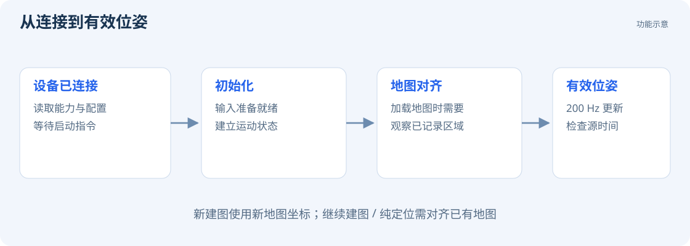

# 位姿与定位状态

位姿由位置与方向组成。SDK 用米表示位置，用四元数表示方向；Viewer 用绿色视锥显示当前位姿。

## 启动状态

| 状态 | 含义 |
| --- | --- |
| 设备在线 | 通信连接已建立 |
| SLAM READY | SLAM 通道已就绪，可发送运行指令 |
| 初始化完成 | 输入已就绪，已建立运动估计 |
| 地图对齐完成 | 继续建图或纯定位时，已建立当前运行与已有地图的坐标关系，可读取有效地图位姿 |

## 检查步骤

1. 确认相机画面正常，标定有效，镜头没有被遮挡。
2. 开始时放稳片刻或缓慢移动，避免剧烈抖动。
3. 确认位姿数值、绿色视锥和跟踪图开始更新。
4. 加载地图时，先在原地图中有明显特征的区域观察和移动。

位姿数据按 200 Hz 更新，图像、地图和界面按各自频率更新。

程序读取位姿的方法见 [SLAM SDK 接入](development/slam.md)。
