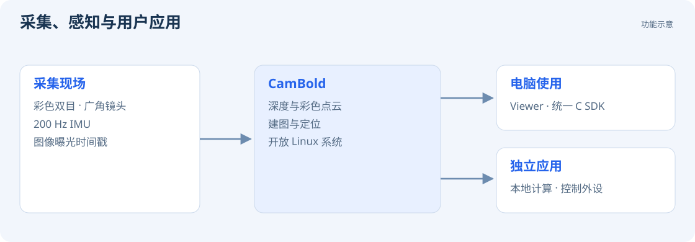

# 产品特点

CamBold 集成图像采集、惯性测量、深度感知和建图定位功能，支持通过 USB 向电脑传输数据，也支持在相机内部独立运行用户程序。

## 彩色双目与惯性测量

彩色双目相机与 IMU 同步采集图像、加速度和角速度。SDK 提供图像的源时间戳和左右目曝光时长，可用于多传感器同步、运动分析和机器人感知。硬件规格见 [规格参数](product/specifications.md)。

## 深度感知与彩色点云

相机提供多档深度分辨率和帧率。Viewer 同时显示校正彩色图、视差图和三维彩色点云。SDK 提供同帧颜色与视差，用于测距、空间检测和三维显示。

相机支持水平使用和垂直使用两种方式。水平模式输出针孔投影图像；垂直模式采用圆柱投影，可设置水平焦距与垂直视场角。具体操作见 [深度图与彩色点云](guides/depth.md)。

## 建图、继续建图与纯定位

Viewer 的 SLAM 页面支持新建地图、继续建图和纯定位。稀疏模式保存定位数据，稠密模式同时保存彩色点云，用于查看场景结构。两种模式均支持定位和重定位。

初始化完成后，相机向 SDK 输出 200 Hz 位姿。地图默认保存到 `/data/share`，可通过 Windows 文件资源管理器备份和删除。

## 开放计算平台

相机运行 Debian 12，支持部署 C / C++、Python 等 Linux 应用。Viewer 提供系统终端，网络连接后可通过 SSH 远程登录。可用计算资源及部署方法见 [系统与交叉编译](development/board.md)。

## 接入电脑或外设

全功能 Type-C 口支持连接电脑进行数据传输和固件升级，也支持连接显示器、扩展坞或 U 盘。GH1.25 10P 接口提供 5 V 电源输入及 CAN、UART、I²C。Wi-Fi 6 与 Bluetooth 5.4 支持无线连接与外设应用。

电脑端与板端 SDK 使用同一套 C API。相机另保留一个自定义 USB 串口，用户可以自行设计通信协议。
