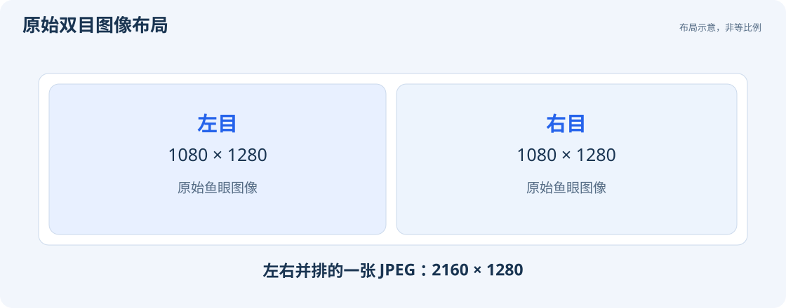

# 规格参数

| 项目 | 规格 |
| --- | --- |
| 主控 | RK3576 |
| 内存 / 存储 | 4 GB / 32 GB；系统和预装文件会占用部分存储空间 |
| 图像传感器 | SC132GS，彩色双目 |
| 镜头 | 200° 广角镜头 |
| 双目基线 | 6 cm |
| 单目彩色图像 | 1080 × 1280，最高 30 fps |
| 双目传输画面 | 左右并排，2160 × 1280，MJPEG |
| 图像帧率档位 | 30 / 20 / 15 / 10 fps；可选项由设备上报 |
| 深度输出 | 多档分辨率与帧率，包含 448 × 252 @ 10 fps |
| IMU | 200 Hz，加速度与角速度 |
| 视觉里程计位姿 | 初始化后 200 Hz；SDK 接收与 UI 绘制频率各自独立 |
| 供电 | **仅 5 V**，建议电源输出能力不低于 2 A |
| 无线 | Wi-Fi 6、Bluetooth 5.4 |
| Type-C | 设备模式、主机模式、显示输出；支持连接电脑、显示器、扩展坞和存储设备 |
| 扩展接口 | GH1.25 10P：5 V 输入、一路 CAN、一路 UART、一路 I²C |
| 操作系统 | Debian 12，AArch64 |
| 电脑端功能 | 图像 / 深度 / 点云显示、ROS1 rosbag 录制、终端、SLAM 与地图管理 |
| SDK | C 接口，电脑端 USB 后端与板端 LOCAL 后端，源码提供 |

## 图像尺寸

`1080 × 1280` 表示每只相机图像的宽和高。UVC 与 SDK 视频回调输出左右并排的一张 JPEG，因此视频回调的宽为 2160、高为 1280。深度输出有独立的分辨率，与原始图像尺寸不同。

## USB 连接

当前固件的数据链路为 USB 2.0 High-Speed，兼容 USB 2.0 和 USB 3.x 数据线及接口。建议使用可靠的短数据线直连电脑。

深度功能的全部分辨率档位见 [深度模式表](guides/depth.md#可选分辨率与帧率)。
