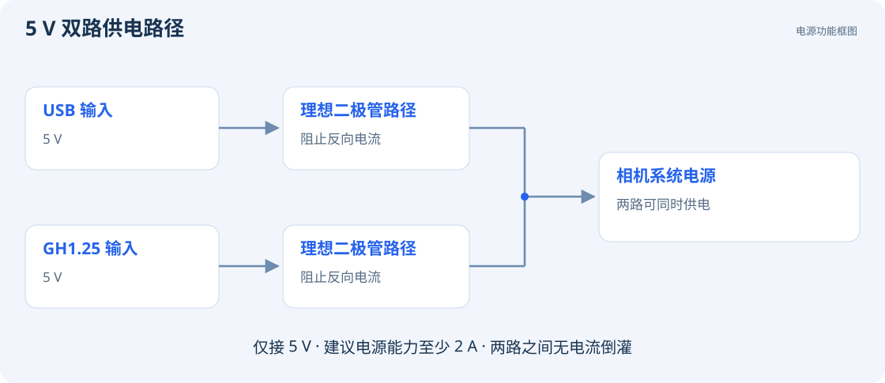
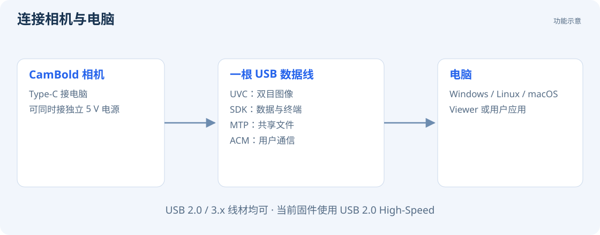

# 包装、供电与连接

## 包装清单

| 物品 | 用途 |
| --- | --- |
| CamBold 相机本体 | 采集图像、IMU，执行深度感知和建图定位 |
| USB 数据线 | 连接电脑、传输数据或进行固件升级 |
| GH1.25 10P 单头线材 | 接入 5 V 电源和 CAN / UART / I²C 外设 |

## 供电要求

相机**仅支持 5 V 输入**，建议使用输出能力至少为 **5 V / 2 A** 的稳定电源。相机可由电脑 USB 口供电，也可通过 GH1.25 接口接入独立 5 V 电源。

USB 与 GH1.25 两路电源允许同时接入，电源路径可阻止两路之间的电流倒灌。接线前核实电源为 5 V，并确认极性。

首次使用时，建议用短 USB 数据线直接连接电脑。

## 连接电脑

1. 将相机放稳，镜头朝向光线正常、有纹理的场景。
2. 将 USB 数据线插入相机 Type-C 口，再连接电脑。
3. 等待相机启动和电脑完成设备识别。
4. 在 Windows 文件资源管理器中查看 MTP 设备，或打开 CamBold Viewer。
5. 确认 Viewer 顶部出现 `online` 后，点击 `Start preview`。

下一步：[Windows 首次连接](start/windows.md)。使用 Linux 或 macOS 的电脑请阅读 [对应连接说明](start/linux-macos.md)。

## 连接显示器或外设

Type-C 也可作为主机连接扩展坞、U 盘和键鼠，并通过支持显示输出的 Type-C 转接设备连接显示器。使用扩展坞和显示器时，建议由 GH1.25 接口为相机独立供电。

切换电脑与扩展坞连接前，先停止录制和建图，再更换线缆。
