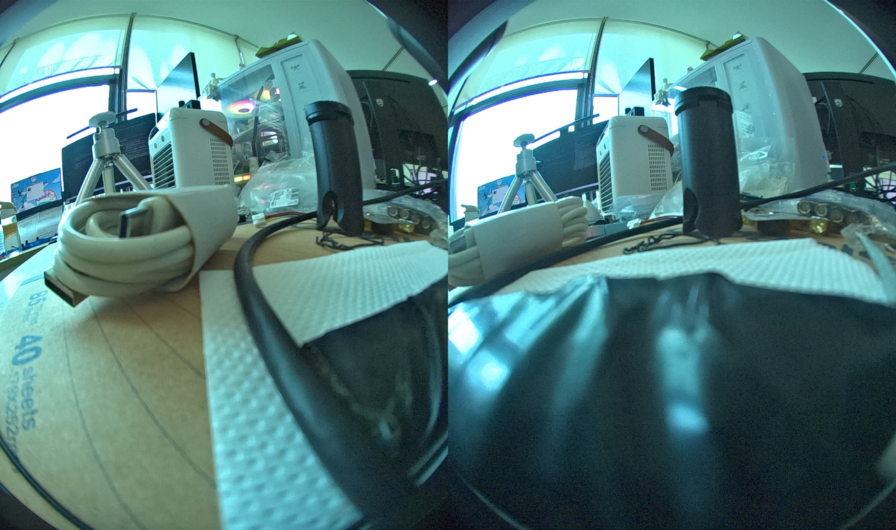
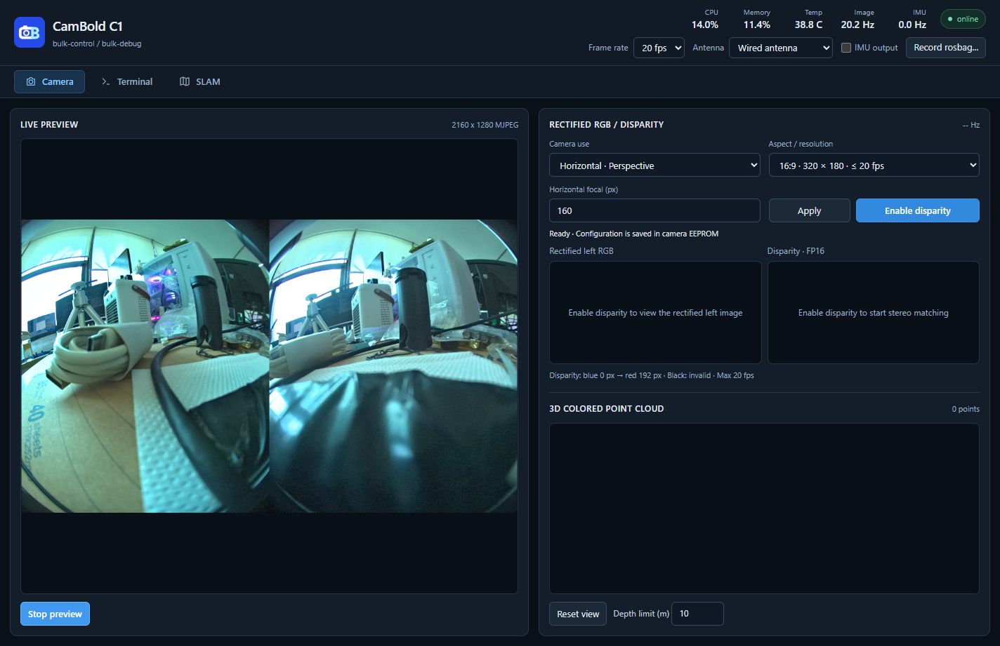

# Windows 首次连接

## 设备入口

| 入口 | 用途 | 打开方式 |
| --- | --- | --- |
| MTP 便携设备 | 传文件、取出地图 | 文件资源管理器 → 此电脑 → CamBold 设备 |
| UVC 相机 | 查看双目图像 | Windows 开始菜单 → 相机 |
| CamBold Viewer | 参数设置、深度、点云、录制、终端、SLAM | 运行 `cambold_viewer.exe` |
| 用户 USB 串口 | 用户自定义通信 | 设备管理器查看 COM 端口，使用串口工具或自己开发的程序 |

MTP 对应相机的 `/data/share` 目录，在资源管理器中显示为便携设备，支持复制和删除文件，通常没有盘符。

## 使用 Windows 自带的相机程序

1. 关闭已占用相机视频的程序。
2. 在开始菜单搜索并打开 **相机**。
3. 若电脑还有内置摄像头，点击切换相机，选择 CamBold 设备。
4. 画面应包含左右两目。原始鱼眼画面边缘弯曲属于镜头成像特点。

## 打开 CamBold Viewer

1. 从产品软件包中找到 `cambold_viewer.exe` 并运行。
2. 程序自动搜索并连接相机。
3. 顶部状态变为 `online` 后，确认设备名称和参数已显示。
4. 在 `Camera` 页面点击 `Start preview` 查看图像。

当前同一台电脑支持连接一台 CamBold 设备。打开 Viewer 前，关闭其他 Viewer 实例和占用视频的程序。

## 连接故障

Viewer 离线时，按 [连接故障排查](support/troubleshooting.md#viewer-离线，找不到相机) 检查供电、数据线、设备占用和驱动。

固件升级所需的 Rockchip 驱动与日常 UVC 使用的驱动不同，安装流程见 [固件升级](guides/firmware.md)。
